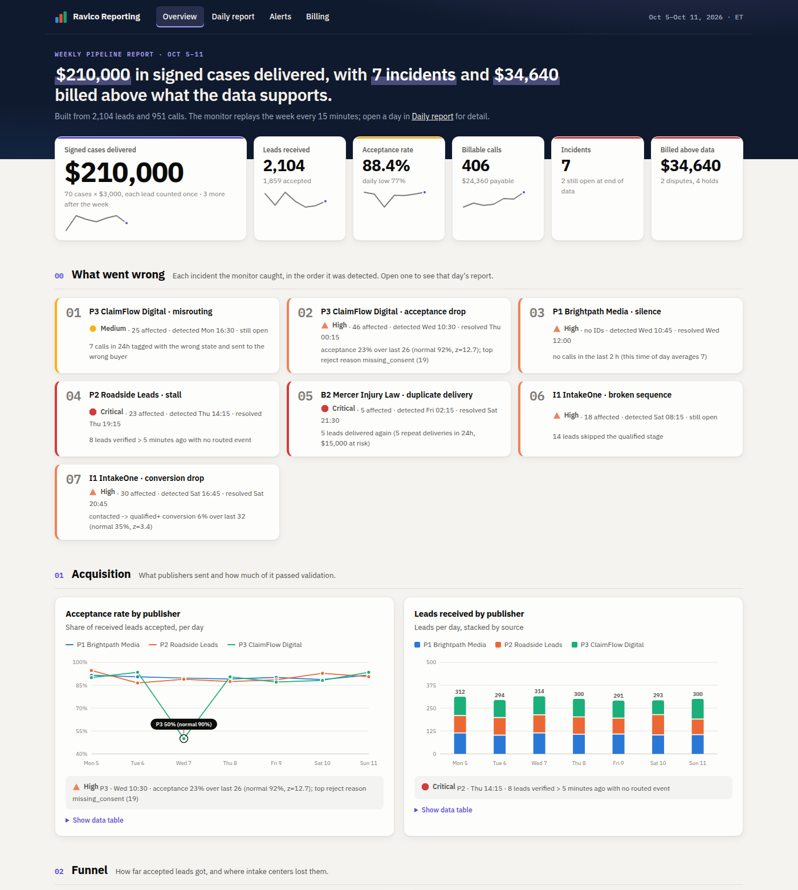
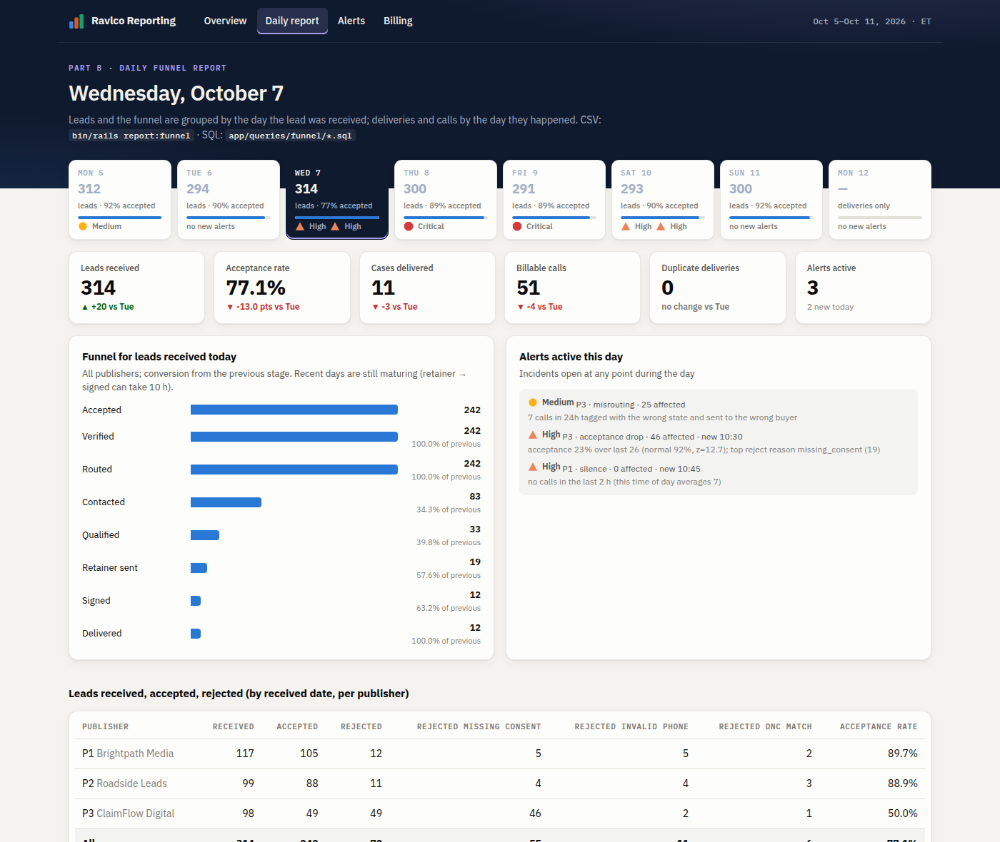
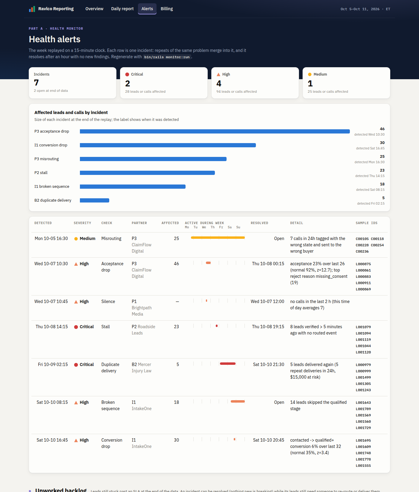
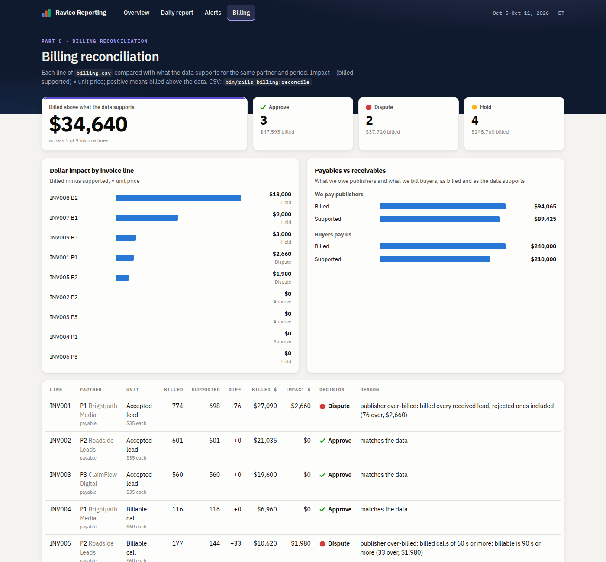

# Ravlco pipeline monitoring & reporting

Rails 8 + SQLite. Data: `db/data/*.csv` (copied from `ravlco_pipeline_assignment_data`).

## Prerequisites

- **Ruby 3.3** (tested on 3.3.8, pinned in `.ruby-version`) with Bundler, which ships with Ruby.
- **A C compiler and the libyaml headers**, for a few gems with native extensions:
  - macOS: `xcode-select --install`, then `brew install ruby libyaml`
  - Ubuntu/Debian: `sudo apt install ruby-full build-essential libyaml-dev`
- **No database server.** SQLite comes precompiled inside the `sqlite3` gem, and the database is rebuilt from `db/data/*.csv`.

## Run

Three commands produce everything:

```
bin/bundle install                                      # 1. install gems
bin/rails db:setup                                      # 2. create the SQLite schema and import the CSVs
bin/rails monitor:run report:funnel billing:reconcile   # 3. Parts A, B, C -> out/
```

Optional:

```
bin/rails test     # 28 tests: the exact incidents, report totals and invoice decisions
bin/rails server   # the UI at http://localhost:3000
```

The outputs from step 3 are already committed in `out/` if you want to read them without running anything:
`alerts.csv` / `alerts.json` and `backlog.csv` (Part A), `funnel_*.csv` (Part B), `reconciliation.csv` (Part C).

## UI

`bin/rails server` → http://localhost:3000. These are server-rendered pages. The charts are inline SVG drawn in
`app/helpers/charts_helper.rb`, so there's no chart library; the only external request is the IBM Plex font from Google Fonts
(without it, the pages fall back to the system font).

| Page | What it shows |
|---|---|
| **Overview** `/` | A headline sentence about the week, KPI tiles with 7-day trend lines, "What went wrong" incident cards that link to the day each happened, and charts grouped as Acquisition, Funnel, and Revenue & calls. Each chart carries the alert that explains it; points far below their usual level are labelled on the chart. |
| **Daily report** `/report/:day` | A week strip (volume, acceptance and new alerts per day), KPIs with change vs the previous day, that day's funnel, active alerts, and the Part B tables |
| **Alerts** `/alerts` | Incidents by severity, size of each incident, the full list with a week timeline and sample IDs, and the unworked backlog |
| **Billing** `/billing` | Amount billed above the data, approve/dispute/hold totals, $ impact per line, billed vs supported, and the reconciliation table |

Every chart has a legend, a "Show data table" option, and hover/focus tooltips. Severity and decisions are shown as an icon plus a label,
never by color alone. The palette was checked for colorblind safety in light and dark mode; dark mode follows the OS setting.

### Screenshots

**Overview:** the week in one sentence, then what went wrong



**Daily report:** Wednesday 10-07, the day P3's consent problem hit



**Alerts:** every incident with its timeline, plus the backlog of leads still stuck



**Billing:** each invoice line against the data, with a decision



## Part A: health monitor

`HealthMonitor::Runner` replays the week on a **15-minute clock** (2026-10-05 00:00 → 10-12 08:00).
At each tick every check sees only rows timestamped `<=` that tick, so the detection time is the time
a live monitor would have fired.

**One incident = one alert.** Findings with the same key (check + partner + sub-type) on consecutive ticks
merge into one alert, and its affected count is the union of IDs seen.
- **Resolving means "stopped happening".** Every check looks only at recent activity (its own lookback, below). An
  incident resolves after 1 hour of clean ticks. Leads that are still stuck after the cause has stopped are a
  separate **backlog** (`out/backlog.csv`, and a card on the Alerts page), because "what still needs work?" is a different
  question from "is it still breaking?".
- **Rate checks confirm on 2 of the last 3 ticks**, so a single noisy window never alerts, but a finding that flaps on alternate ticks still does.
- **Rate baselines freeze while an incident is open**, so a long problem can't become the new normal and close itself.
- **The detail is the worst tick's**, not the last one's (for P3: 23% acceptance at z = 12.7, not the tail-off at 22:45).

Output columns: `detected_at, check_name, severity, partner_id, affected_count, sample_ids, last_new_at, resolved_at, detail`.
`last_new_at` is the last tick that added a new affected ID (≈ when the problem stopped growing). A blank
`resolved_at` means it was still happening when the data ended.

### Checks and thresholds

The thresholds come from the observed data, not guesses. Normal stage latencies in this week: received→verified ≤ 6 s,
verified→routed ≤ 12 s, routed→contacted ≤ 90 min, contacted→qualified ≤ 40 min, qualified→retainer ≤ 10 min,
retainer→signed ≤ 10 h, signed→delivered ≤ 6.4 min.

| Check | Fires when | Lookback | Why this threshold |
|---|---|---|---|
| `stall` | ≥3 accepted leads per publisher newly past 5 min without `verified`/`routed`; ≥1 signed lead not delivered after 30 min | 1 h | The SLA is 1 min; 5 min absorbs ingestion lag. 3 leads separates an outage from one stuck lead. Critical at 5+ per hour (≈ all of a publisher's traffic) or for any delivery. Later stages aren't stall-checked: most leads stop there by design. |
| `duplicate_delivery` | A lead delivered again after its first delivery | 24 h | Every occurrence double-bills a buyer. Critical. Deliveries are sparse, so a shorter lookback would split one incident. |
| `acceptance_drop` | Publisher acceptance over the last 4 h is ≥20 pp below its baseline, z ≥ 3, n ≥ 20 | 4 h window | 4 h ≈ 22 leads per publisher. Below n=20, 5 random rejects look like a 25 pp drop (this produced 2 false alarms during tuning). Affected IDs are the dominant reject reason only. |
| `conversion_drop` | Intake stage→next-stage-or-later conversion over 12 h is down by the same rule. Each cohort is judged only after ~1.5× the slowest normal transition. | 12 h window | Intake volume is low (2–3 contacts/h). "Or later" means a skipped stage is left to `broken_sequence` and not double-alerted. |
| `broken_sequence` | A stage exists without the previous one, or a rejected lead has pipeline events (15 min grace for out-of-order events) | 24 h | Data integrity: any occurrence. I1 sends ~1 retainer every 2 h, so a short lookback would split it. |
| `misrouting` | Lead routed/delivered to a partner not allowed for its state (≥1); calls whose buyer ≠ buyer for the **caller's actual state** (≥2 per publisher), split into `call_state_tag` (bad tag) and `call_router` (good tag, wrong buyer) | 24 h | A wrong tag that still maps to the right buyer (e.g. TX tagged GA, both B1) is not counted. |
| `silence` | A publisher's leads or calls are zero for 2 h at a time of day that averaged ≥ 6 on earlier days | 2 h | Rate checks can't see silence: no rows, no rate. Overnight windows never qualify. Not judged past the last row of the export. |
| `failed_events` | ≥3 leads with a non-`success` event from one partner | 1 h | One failure is a retry; three in an hour is an integration outage. None this week (all 4,830 events are `success`). |

**Checked, nothing found** (so these are known, not missed): call connect rates per publisher per day (0.64–0.89, nothing out of line),
duplicate leads across publishers by `phone_hash` (none), leads delivered to more than one buyer (none), and
volume gaps in leads (only overnight). 5 calls have `connected = true` with `duration_sec = 0`: not billable, so no money
impact, but it's a data quality flag for the call tracker.

### Result for the week (`out/alerts.csv`)

7 alerts, all real, no false alarms:

| Detected | Check | Partner | Affected | Resolved | Notes |
|---|---|---|---|---|---|
| 10-05 16:30 | misrouting (state tag) | P3 | 25 calls | open | Mis-tagged calls all week, last 10-11 17:44 |
| 10-07 10:30 | acceptance_drop | P3 | 46 leads | 10-08 00:15 | `missing_consent` |
| 10-07 10:45 | silence (calls) | P1 | — | 10-07 12:00 | No P1 calls 08:40–11:10 (≈7 expected); the only daytime gap this week |
| 10-08 14:15 | stall (routed) | P2 | 23 leads | 10-08 19:15 | Stopped at 17:19, but all 23 are still unrouted (backlog) |
| 10-09 02:15 | duplicate_delivery | B2 | 5 leads | 10-10 21:30 | $15,000 double-billed; last repeat 10-09 20:44 |
| 10-10 08:15 | broken_sequence (no qualified) | I1 | 18 leads | open | Still happening at end of data |
| 10-10 16:45 | conversion_drop (contacted) | I1 | 30 leads | 10-10 20:45 | Same root cause, seen from the funnel. It resolves because retainers count as "qualified or later"; `broken_sequence` stays open |

## Part B: daily funnel report

The SQL is in `app/queries/funnel/*.sql`. It runs through `FunnelReport` and is written by `bin/rails report:funnel` to
`out/funnel_{leads,stages,deliveries,calls}.csv`, one row per day × partner plus a daily `ALL` row.
`/report/:day` shows the same data as a one-day morning report, with that day's active alerts at the top.

| Section | Grouped by | Notes |
|---|---|---|
| Leads | received date × publisher | Received, accepted, rejected per reason, acceptance rate |
| Funnel | received date × publisher **and** × intake center | Accepted leads only (cohort). Each lead counts once per stage it reached. Conversion = stage / previous stage. A rate >100% or "—" means a stage was skipped (I1 on 10-10/11). |
| Deliveries | first delivery date × buyer | Each lead counted **once**. Repeat delivery events appear as `duplicate_deliveries` and are not counted as revenue. |
| Calls | call date × publisher | Billable = connected and ≥ 90 s; payable = billable × $60 |

Cohorting the funnel by received date keeps the conversion rates meaningful: by event date, each stage would be counting different leads.
The cost is that the most recent days are still maturing. Some deliveries are dated 10-12 (Sunday-night signings), so the report has an 8th day.

## Part C: billing reconciliation

`BillingReconciler` recounts each line from the data for the same partner and period (`period_end` inclusive).
Accepted leads are counted by received date, billable calls by start date, and signed cases as distinct leads by first delivery date.
It also computes the common *wrong* ways to count (every received lead, ≥60 s calls, every delivery event,
deliveries after the period). If the billed units equal one of these, it is reported as the cause.
`bin/rails billing:reconcile` → `out/reconciliation.csv`; `/billing` shows the same table.

| Line | Billed | Supported | Impact | Decision | Why |
|---|---|---|---|---|---|
| INV001 P1 leads | 774 | 698 | $2,660 | **dispute** | Billed every received lead, including 76 rejects |
| INV002 P2 leads | 601 | 601 | 0 | approve | |
| INV003 P3 leads | 560 | 560 | 0 | approve | The 10-07 consent rejects were not billed |
| INV004 P1 calls | 116 | 116 | 0 | approve | |
| INV005 P2 calls | 177 | 144 | $1,980 | **dispute** | Counted calls ≥ 60 s; billable is ≥ 90 s |
| INV006 P3 calls | 146 | 146 | 0 | **hold** | 8 billable calls were mis-tagged to the wrong buyer: approve 138, hold $480 for a policy decision |
| INV007 B1 cases | 40 | 37 | $9,000 | **hold** | 1 case delivered 10-12 (next period). 2 are not in the data at all: the invoice may be wrong **or delivery events were lost** (then we under-bill), so investigate before correcting |
| INV008 B2 cases | 22 | 16 | $18,000 | **hold** | Our invoice counted delivery events: 5 duplicates + 1 delivered 10-12 |
| INV009 B3 cases | 18 | 17 | $3,000 | **hold** | Our invoice includes 1 case delivered 10-12 |

Decision rules: matching and clean → approve. Publisher bills more than supported → dispute. Our own receivable invoice
is wrong → hold and correct it before sending (we don't dispute ourselves). Units match but some are questionable, the
price ≠ contract, or a partner billed less than supported → hold.

## Assumptions

- Timestamps are US Eastern wall-clock and are stored without conversion (no DST change inside the week).
- An event is visible to the monitor at its own timestamp (no ingestion delay in the data).
- Billing periods are by event time: a case delivered 10-12 00:xx belongs to the next invoice even if it was signed on 10-11.
- Row counts differ from the brief (leads 2,104 vs 2,087, events 4,830 vs 4,818, calls 951 vs 976). The data is used as given.
- The baseline for rate checks is everything earlier in the week. A real system would use weeks of history by hour of day.

## Part D: findings

See [FINDINGS.md](FINDINGS.md) (1 page): six problems, each with its window, impact, root cause, who to escalate to, and the fix.

## Next steps (with another day)

1. **Run it live.** Run the checks every 15 min as a Solid Queue recurring job against incremental data, and send
   critical alerts to PagerDuty and the rest to Slack, with partner owners on each alert.
2. **Per-reason and per-hour baselines.** A `missing_consent` rate alert would have caught finding 1 about 3½ h earlier.
   Baselines should be by hour of day and day of week, once there are several weeks of history.
3. **Prevent, not just detect.** Add a unique (lead, `delivered`) constraint, reject `retainer_sent` without `qualified`,
   route calls on the caller's state, and retry unrouted leads automatically.
4. **Reconciliation as an invoice gate.** Generate invoices from the reconciliation SQL, and block sending when a line isn't approved.
5. **Alert quality tracking.** Record acknowledged/false-alarm per alert and report precision per check, to tune thresholds on evidence.
6. **Report improvements.** Compare each day with the previous day and the 7-day average, add a week-total view,
   and drill down from an alert to its leads or calls.
7. **Postgres and a proper ingestion layer** (idempotent loads, late-arriving events) in place of a full CSV reload.

## AI use

Claude Code (AI) wrote the code and the write-up. What I verified myself:
- Every anomaly was first found with raw SQL directly against the CSVs, independently of the Rails code. The monitor,
  report and reconciliation were then checked against those numbers.
- The tests pin those numbers: `test/services/health_monitor_test.rb` (the exact 6 incidents),
  `funnel_report_test.rb` (report totals) and `billing_reconciler_test.rb` (every invoice decision).
- The thresholds were tuned by running the monitor and inspecting each alert. Two false alarms were seen and removed (documented above).
- The pages were checked in headless Chrome at desktop and phone widths.
